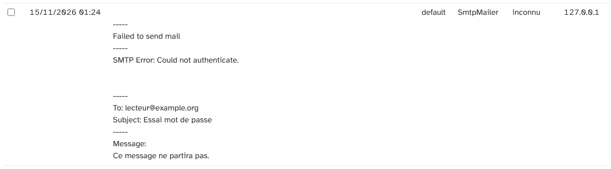

# SmtpMailer : guide d'utilisation

SmtpMailer fait envoyer les e-mails de Dotclear par un serveur SMTP, avec identifiant et mot de passe, au lieu de la fonction `mail()` de PHP. Il sert, par exemple, quand votre hébergement n'envoie pas de mails, ou quand vous voulez passer par la messagerie de votre fournisseur.

L'auteur le décrit comme un plugin « incomplet, qui répond à son besoin » : utilisez-le en connaissance de cause.

Le plugin n'a pas de page d'administration. Il se règle en ajoutant des lignes dans le fichier `config.php` de Dotclear.

## Sommaire

* [Régler le serveur SMTP](#régler-le-serveur-smtp)
* [Ce que le plugin envoie](#ce-que-le-plugin-envoie)
* [Tester l'envoi](#tester-lenvoi)
* [Quand l'envoi échoue](#quand-lenvoi-échoue)
* [Bon à savoir](#bon-à-savoir)

## Régler le serveur SMTP

Ouvrez le fichier `inc/config.php` de Dotclear et ajoutez ces lignes à la fin, avec vos propres valeurs :

```php
define('SMTP_MAILER_HOST', 'smtp.mon-hebergeur.net');
define('SMTP_MAILER_USERNAME', 'identifiant');
define('SMTP_MAILER_PASSWORD', 'mot-de-passe');
define('SMTP_MAILER_FROM', 'blog@mon-domaine.net');
define('SMTP_MAILER_STARTTLS', true);
```

* `SMTP_MAILER_HOST` : le nom du serveur SMTP.
* `SMTP_MAILER_USERNAME` et `SMTP_MAILER_PASSWORD` : l'identifiant et le mot de passe de la boîte.
* `SMTP_MAILER_FROM` : l'adresse de l'expéditeur. C'est aussi l'adresse de réponse.
* `SMTP_MAILER_STARTTLS` : `true` pour le chiffrement STARTTLS sur le port 587, `false` pour le chiffrement SSL direct sur le port 465.

Les quatre premières lignes sont obligatoires. Sans elles, le plugin ne fait rien et Dotclear garde son envoi habituel.

Le port ne se règle pas : il dépend uniquement de la ligne `SMTP_MAILER_STARTTLS`. Le serveur doit accepter l'authentification et un certificat de confiance, sinon l'envoi échoue.

## Ce que le plugin envoie

Une fois les lignes ajoutées, tous les mails de Dotclear et des plugins passent par le serveur SMTP : notifications, mails de test, etc.

Dans le message reçu :

* l'expéditeur est « Dotclear » avec l'adresse `SMTP_MAILER_FROM` ;
* l'adresse de réponse est la même adresse, avec le nom « no reply » ;
* le texte est envoyé en UTF-8, en texte brut ;
* les autres en-têtes ajoutés par un plugin sont conservés, sauf celui qui fixe l'expéditeur (`From:`).

## Tester l'envoi

Le plugin testMail permet d'envoyer un mail depuis l'administration, pour vérifier la configuration :

1. Ouvrez « Mail test » dans le menu « Système ».
2. Saisissez une adresse, un sujet et un message.
3. Cliquez sur « Envoyer ».
4. Vérifiez dans la boîte de réception.

## Quand l'envoi échoue

Un échec ne s'affiche pas à l'écran : Dotclear indique quand même que le mail est envoyé. Il faut regarder le journal du blog, avec le plugin dcLog.

Chaque échec y est noté avec le composant « SmtpMailer », la cause de l'erreur, le destinataire, le sujet et le texte du message. Par exemple, pour un mauvais mot de passe : « SMTP Error: Could not authenticate. ».



Les causes les plus courantes :

* un mot de passe ou un identifiant faux : « Could not authenticate » ;
* un serveur injoignable : « Could not connect to SMTP host » ;
* un certificat que PHP ne reconnaît pas : « certificate verify failed ».

## Bon à savoir

* Le mot de passe SMTP est écrit en clair dans `config.php` : protégez ce fichier.
* Un mail en échec n'est pas renvoyé. Le texte du message reste dans le journal.
* Le plugin utilise la bibliothèque PHPMailer, fournie avec lui.
* L'expéditeur affiché est celui de `SMTP_MAILER_FROM`, pas celui que Dotclear ou un plugin demande.
